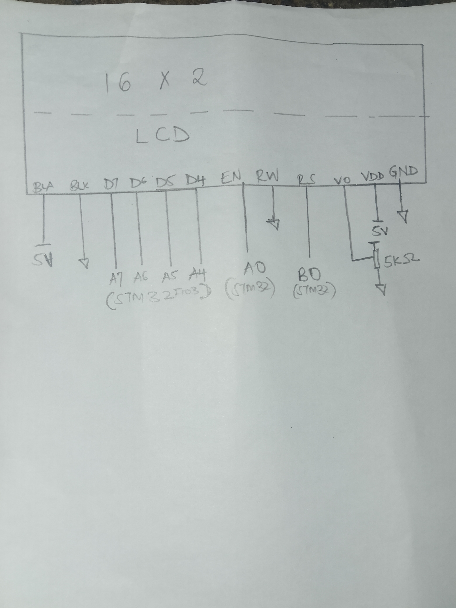
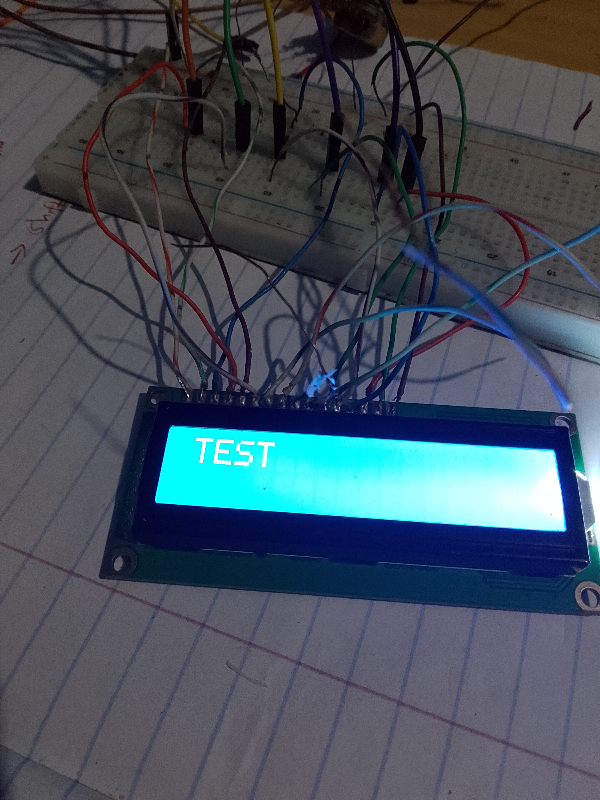

# LCD DRIVER PROGRAM
In this project I use stm32f103 to display text on the screen  
The witing diagram is as shown in the diagram  
4 bit mode is used to minimize pins used  

###WIRING DIAGRAM

###TEST PROGRAM

