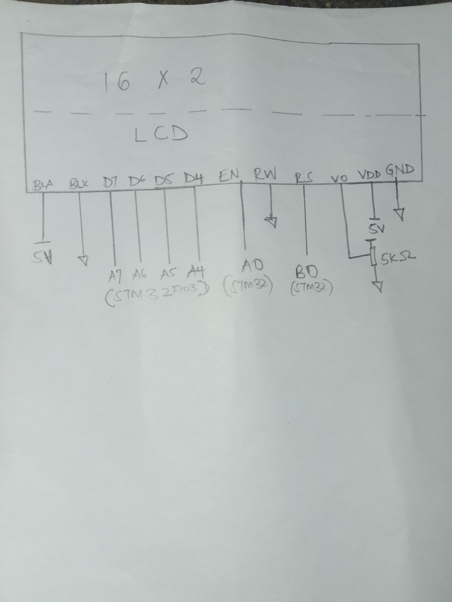
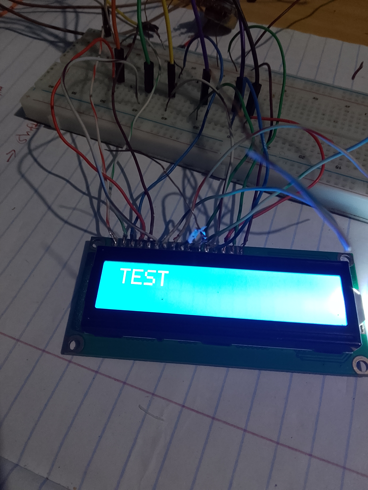

# LCD Driver for STM32F103 (4-Bit Mode)

This project provides a C library to interface an **HD44780-compliant LCD character display** with an **STM32F103 microcontroller**. The driver utilizes **4-bit mode** to minimize the number of GPIO pins required.

---

## Hardware Overview

### Wiring Diagram


### Pin Mapping Table

| LCD Pin | Function | STM32F103 Pin | Description |
| :--- | :--- | :--- | :--- |
| **VSS** | Ground | GND | System ground |
| **VDD** | Power | 5V / 3.3V | Power supply |
| **V0** | Contrast | Wiper Pin | Connected to a potentiometer |
| **RS** | Register Select | *[Insert Pin]* | Selects data or instruction register |
| **RW** | Read/Write | GND | Kept LOW for write-only mode |
| **E** | Enable | *[Insert Pin]* | Initiates data transfer |
| **D4** | Data 4 | *[Insert Pin]* | Bi-directional data line |
| **D5** | Data 5 | *[Insert Pin]* | Bi-directional data line |
| **D6** | Data 6 | *[Insert Pin]* | Bi-directional data line |
| **D7** | Data 7 | *[Insert Pin]* | Bi-directional data line |
| **A / K**| Backlight | VCC / GND | Backlight power and ground |

---

## Driver Demonstration


---

##  File Structure & Architecture

To use this driver, include the following core file pairs in your project:

* **`text.h` / `text.c`**  
  Handles text parsing and converts standard strings into character sequences compatible with the HD44780 controller.
* **`lcd.h` / `lcd.c`**  
  Contains the core display driver functions, pin configurations, command routines, and low-level data writing.
* **`systeminit.h` / `systeminit.c`**  
  Initializes the system clock (RCC) and configures the SysTick timer to provide the precise microsecond/millisecond delays required during LCD initialization.

---

## Quick Start Guide

### 1. Project Integration
Add the source files to your project directories and include the headers in your `main.c`:

```c
#include "systeminit.h"
#include "text.h"
#include "lcd.h"
#include "stm32f103xb.h"

**//Remember to enable irq. For systick to be effective**

```
